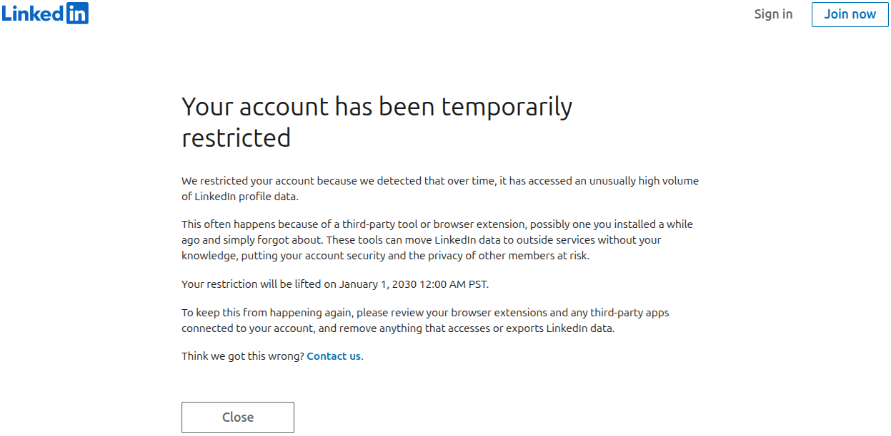

# Linkedin Scraper



This repository contains Python scripts that scrape Linkedin profiles and their connections. If you actually want to use this code, please read [Automated activity on Linkedin](https://www.linkedin.com/help/linkedin/answer/a1340567/automated-activity-on-linkedin?lang=en) first.

## Installation

To use this code, you need to install the dependencies from the [`requirements.txt`](../requirements.txt) file. You can do this by running the following command:

```bash
pip install -r requirements.txt
```

To scrape Linkedin, you need to be logged in and use a very realistic browser. The solution is to create a copy of `~/.config/google-chrome` and use it with Selenium. It doesn't work with the original directory; it needs to be a copy. This means that to make this work, you need to be in a Linux environment where the configuration files are stored in `~/.config/google-chrome` and be logged into LinkedIn in that browser.

## [`main.py`](../main.py)

This script scrapes Linkedin profiles and their connections. All of their information is stored in a `.json` file called [`profiles.json`](../profiles.json). The script does the following:

1. Scrapes all the [connections](https://www.linkedin.com/mynetwork/invite-connect/connections/) of your Linkedin account. The references to the profiles are stored in the [`connections.json`](../connections.json) file.
2. Scrapes the suggested profiles in the [`Grow your network`](https://www.linkedin.com/mynetwork/grow/) section of Linkedin.
3. Scrapes the profiles of the people who have sent you invitations to connect from the section [`Received invitations`](https://www.linkedin.com/mynetwork/invitation-manager/received/). The references to the profiles are stored in the [`invitations.json`](../invitations.json) file.
4. This is where the main profiles are scraped. In all other steps, only the small div with some information is scraped. For example, [this is your main profile](https://www.linkedin.com/in/me). With this, you can see the number of connections in common and the `linkedinID` of the profile, which is needed to scrape their connections.
5. Finally, it scrapes the connections of profiles that have been found in the previous step. It will only try to find more connections if it hasn't done so recently and if all the connections haven't been found yet. The connections are bidirectional and stored in the [`connections`](../connections/) folder.

A very important variable that you could change to avoid getting your account temporarily restricted is `randomSeconds: float = 60` in the [`fileUtils.py`](../fileUtils.py) file.

## Graphs

To create graphs of the connections, you can use the [`graphData.py`](../graphData.py) script. It creates two files using the `NetworkX` library.

In [`graphData.py`](../graphData.py) there is a boolean variable called `USE_SELF` that controls whether to include your own profile in the graph or not. It will be a node that has connections to the profiles in [`connections.json`](../connections.json).

### [`LinkedinGraphKnown.html`](../LinkedinGraphKnown.html)

This graph only contains the profiles that are among your connections and the connections between them.

### [`LinkedinGraphComplete.html`](../LinkedinGraphComplete.html)

This graph contains everything that has been scraped.

### `LinkedinGraph{i}.html`

This graphs contains the Unkown profiles that have `{i}` connections and the Known profiles. It only keeps the edges between the Known and Unknown.

### `LinkedinGraph{i}_Known.html`

This graphs contains the Unkown profiles that have `{i}` connections and the Known profiles. It keeps all the edges.

## Scores

The script [`graphData.py`](../graphData.py) also creates web pages with scores for each profile. Each profile is shown with their name, profile picture, location, and current job, when available. The score is an average of three different scores:

$$
\text{neighbourhoodExclusivity} =
\begin{cases}
    0 & \text{if } n_{\text{connections}} = 0 \\
    \displaystyle
    \frac{100}{n_{\text{connections}}}
    \sum_{v \in \text{connectedNodes}}
    \frac{1}{n_{\text{connections}}(v)}
    & \text{otherwise}
\end{cases}
$$

$$
\text{knownConnectionsPercentage} = 100 * \frac{n_{\text{known connections}}}{\text{len(firstConnections)}}
$$

$$
\text{knownConnectionsOfTotalPercentage} =
\begin{cases}
    0 & \text{if } n_{\text{connections}} \text{is \textit{None}} \\
    0 & \text{if } n_{\text{connections}} = 0 \\
    100 * \dfrac{n_{\text{known connections}}}
    {n_{\text{connections}} + n_{\text{known connections}}}
    & \text{otherwise}
\end{cases}
$$

Then each score is normalized so the maximum score for each is 100. The exception is `neighbourhoodExclusivity`, which uses the maximum value for each type of node (`Known` for first connections and `Unknown` for second connections).

$$
\text{score}_i =
\dfrac{100}{3}
\left(
    \dfrac{\text{knownConnectionsPercentage}_i}{max(\text{knownConnectionsPercentage})}
    +
    \dfrac{\text{knownConnectionsOfTotalPercentage}_i}{max(\text{knownConnectionsOfTotalPercentage})}
    +
    \begin{cases}
        \dfrac{\text{neighbourhoodExclusivity}_i}{max(\text{neighbourhoodExclusivity}_\text{Known})} & \text{if } i \in \text{Known} \\
        \dfrac{\text{neighbourhoodExclusivity}_i}{max(\text{neighbourhoodExclusivity}_\text{Unknown})}
        & \text{if } i \in \text{Unknown}
    \end{cases}
\right)
$$

This score is used to sort the profiles, but it was created by me to try to find the profiles most important in relation to your profile. It doesn't really have a mathematical basis, but it is a good way to sort the profiles.

In [`graphData.py`](../graphData.py) there is a boolean variable called `USE_SELF` that controls whether to include your own profile in the graph. It will be a node that has connections to the profiles in [`connections.json`](../connections.json).

### [`profiles.html`](../profiles.html)

This page contains all the profiles that have connections.

### [`profilesKnown.html`](../profilesKnown.html)

This page only contains the profiles that are among your connections.

### [`profilesUnknown.html`](../profilesUnknown.html)

This page only contains the profiles that are not among your connections.

## Contributing

If something fails or it is not working, please open an issue. When [`main.py`](../main.py) is run, it stores the html of each profile found in the [`tests`](../tests) folder depending on the type of profile. You can use these to identify what is failing in your profiles. This is controlled with the boolean `STORE_PROFILES` in [`fileUtils.py`](../fileUtils.py). The repository already has some profiles of famous people stored and the information that should be scraped from them. To change the code, all tests must pass.
